# Poultry disease classification from droppings photos, evaluated honestly

**What do these droppings resemble?** A ResNet50 classifier looks at a photo of chicken droppings and says
which of four classes it resembles most: **Coccidiosis**, **Salmonella**, **Newcastle disease (NCD)** or
**Healthy**, with a class activation map of where it looked. It runs entirely in your browser with
TensorFlow.js: no server, no upload. It is right on **96.7%** of held-out photos from its training data, but
only on **79.5%** of a separately collected, PCR-confirmed set, and this README is mostly about that gap.

[](https://peerzadarabet1807.github.io/poultry-disease-detection/)
[](https://colab.research.google.com/github/peerzadarabet1807/poultry-disease-detection/blob/main/notebooks/poultry_disease_resnet50_training_executed.ipynb)
[](https://github.com/peerzadarabet1807/poultry-disease-detection/actions/workflows/ci.yml)
[](LICENSE)
[](https://www.tensorflow.org/)
[](https://www.tensorflow.org/js)

<p align="center">
  <a href="https://peerzadarabet1807.github.io/poultry-disease-detection/">
    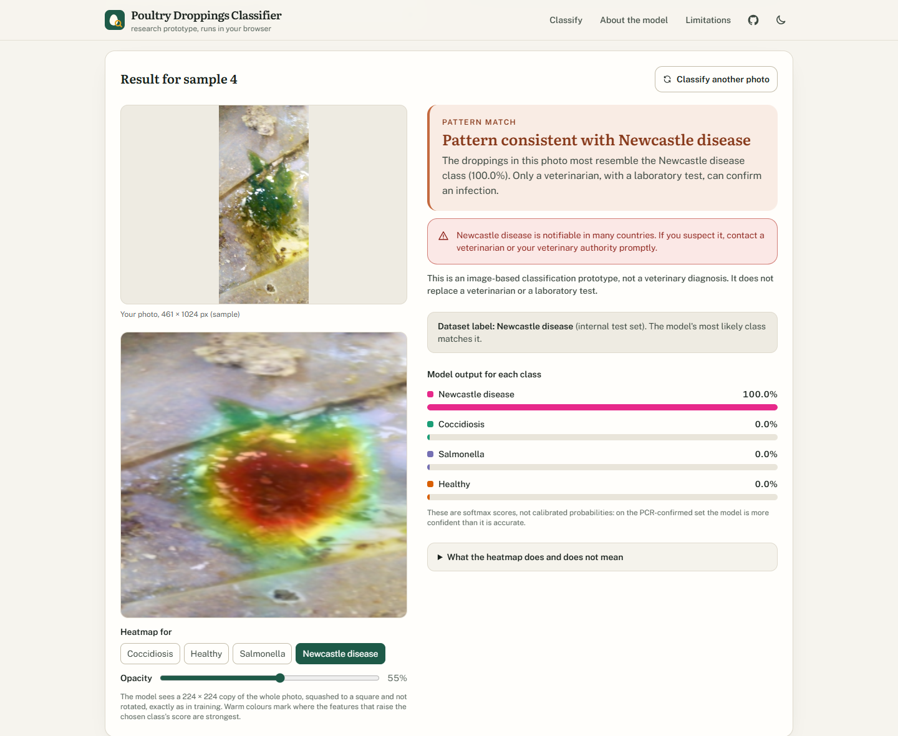
  </a>
  <br>
  <b><a href="https://peerzadarabet1807.github.io/poultry-disease-detection/">Try the live demo →</a></b>
  &nbsp;(47 MB model, downloaded once and cached; no server, no upload)
</p>

> **Research prototype.** This is an image-based classification prototype, not a veterinary diagnosis. It does
> not replace a veterinarian or a laboratory test. Read the [limitations](#limitations-and-threats-to-validity)
> before trusting a result; the most important one is that accuracy drops by about 17 points on photos the
> model was not trained on.

## TL;DR

| Test set | Images | Accuracy (95% CI) | Macro-F1 (95% CI) | Calibration error (ECE) |
|---|---|---|---|---|
| Internal: held-out photos from version 2 of the dataset | 974 | **96.7%** (95.6 to 97.7) | **0.954** (0.935 to 0.972) | 0.017 |
| External: separately collected, PCR-confirmed (version 3) | 1,201 | **79.5%** (77.3 to 81.7) | **0.794** (0.770 to 0.817) | 0.120 |

Intervals: stratified bootstrap of the saved predictions, post-hoc ([`bootstrap_ci.json`](results/posthoc/bootstrap_ci.json)).

**The honest headline.** On held-out photos from the data it was trained on, the model is about **97%**
accurate. On 1,201 photos collected separately and labelled by PCR, it is about **80%** accurate (the gap is
17.2 points, 95% CI 14.7 to 19.7), and its confidence no longer means what it says: it is 91.5% confident on
average but 79.5% right. When it says "Healthy" on that set, it is right 72% of the time. This run is also the
best of five identical training runs on the external set; the five-run mean is **76.3%**. Expect the lower
numbers, or worse, on your own photos. And because the model always picks one of its four classes, it gave a
confident verdict for 8 of 12 photos that were not poultry droppings at all, including all five photos of
other animals' droppings.

## Contents

[The problem](#the-problem) · [Dataset](#dataset) · [Method](#method) · [Results](#results) ·
[Explainability](#explainability) · [Limitations](#limitations-and-threats-to-validity) · [Web app](#the-web-app) ·
[Reproduce](#reproduce-the-training) · [Run locally](#run-the-web-app-locally) ·
[Repository](#repository-structure) · [Model card](#model-card) · [Roadmap](#roadmap) · [Citation](#citation)

## The problem

Coccidiosis, salmonellosis and Newcastle disease are among the costliest diseases of chickens, especially for
small and medium farms. All three change the birds' droppings, and droppings are easy to photograph, so an
image classifier is an appealing first screen: cheap, fast and available wherever there is a phone.

The four classes:

| Class | What it is |
|---|---|
| Coccidiosis | A parasitic intestinal disease caused by *Eimeria* protozoa |
| Salmonella | Infection with *Salmonella* bacteria (salmonellosis) |
| Newcastle disease (NCD) | A viral disease of birds, notifiable to the veterinary authority in many countries |
| Healthy | Droppings from birds the dataset labels as healthy |

**Why PCR-confirmed labels matter.** A photo's label is only as good as the way it was assigned. In version 2
of the dataset, the label follows from where and how a photo was collected; in version 3, each photo's fecal
sample was tested by PCR. Version 3 was never used for training or model selection, so it is the closest thing
here to "new photos from the field", and the number to keep in mind for real-world use.

## Dataset

Machuve, Nwankwo, Mduma, Mbelwa, Maguo and Munisi, *Machine Learning Dataset for Poultry Diseases Diagnostics*
([version 2, doi:10.5281/zenodo.4628934](https://doi.org/10.5281/zenodo.4628934)) and Machuve, Nwankwo, Lyimo,
Maguo and Munisi, *… PCR annotated* ([version 3, doi:10.5281/zenodo.5801834](https://doi.org/10.5281/zenodo.5801834)),
Zenodo, **CC BY 4.0**. Phone photos taken in the Arusha and Kilimanjaro regions of Tanzania between September
2020 and February 2021 (Open Data Kit). Funded by IDRC (grant 109187-002) and OWSD (grant 4500406715).

<p align="center">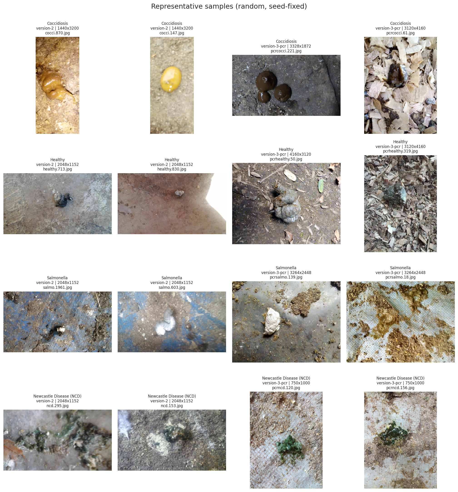</p>

**One fact about collection shapes everything else.** In version 2, Healthy and Coccidiosis photos were taken on
poultry farms, while Salmonella and NCD photos were taken from chickens **inoculated** with those diseases
(Salmonella after one week, NCD within three days). Different birds, possibly different housing and floors:
the classes may differ in their surroundings as well as in their droppings.

**Audit and cleaning** ([`dataset_audit.json`](results/dataset_audit.json)). 8,067 files were found. 334 exact
duplicates were removed, and 38 files in 19 groups of byte-identical images that carried **different labels**
were dropped altogether, leaving 7,695 images. Near-duplicates (perceptual hash) were grouped so they cannot
straddle the split.

**Split** ([`split_summary.csv`](results/split_summary.csv)), stratified by class and source:

| Split | Coccidiosis | Healthy | Salmonella | NCD | Total |
|---|---|---|---|---|---|
| Train (version 2) | 1,378 | 1,440 | 1,467 | 262 | 4,547 |
| Validation (version 2) | 296 | 306 | 315 | 56 | 973 |
| Internal test (version 2) | 296 | 308 | 314 | 56 | 974 |
| External test (version 3, PCR) | 357 | 312 | 346 | 186 | 1,201 |

NCD is the rare class (7% of images), so training used class weights (NCD 4.34).

**Availability and license.** The photos are public under CC BY 4.0. This repository includes 18 of them,
unchanged, as test fixtures ([`tests/fixtures/`](tests/fixtures/README.md)), and 11 downscaled copies as
samples in the web app, credited in both places. [`scripts/fetch_zenodo_images.py`](scripts/fetch_zenodo_images.py)
fetches any other image directly from the Zenodo zips (HTTP range requests), checked against the MD5s the
training notebook recorded.

## Method

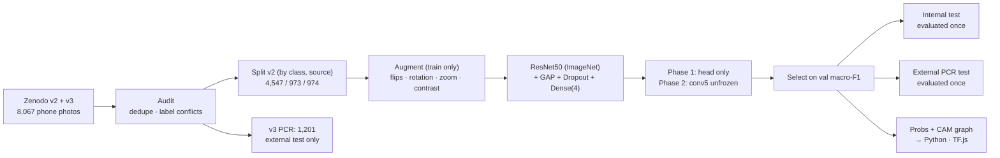

**Architecture.** `image (224×224×3) → ResNet50 (ImageNet, include_top=False) → GlobalAveragePooling →
Dropout(0.3) → Dense(4, softmax)`.

**Preprocessing contract.** One contract, implemented three times and proven equal by tests
([`models/PARITY.md`](models/PARITY.md)):

1. Decode to RGB **without** EXIF rotation (`tf.io.decode_image(channels=3)`).
2. Resize the whole frame to 224 × 224 with **antialiased bilinear** filtering (`tf.image.resize(..., antialias=True)`),
   aspect ratio not kept; round half to even, clip, `uint8`.
3. `resnet50.preprocess_input` ("caffe": RGB → BGR, subtract the ImageNet channel means).

| | Training (Colab) | Python package | Browser |
|---|---|---|---|
| Decode | `tf.io.decode_image` | same | `createImageBitmap(imageOrientation: "none", colorSpaceConversion: "none")` |
| Resize | `tf.image.resize`, bilinear, antialias | same | [`resize.ts`](web/src/lib/resize.ts), a float32 port, **bit-identical** to TF |
| Normalise | `preprocess_input` | NumPy, float32 | [`preprocess.ts`](web/src/lib/preprocess.ts), float32 |

**Augmentation rationale.** Droppings have no canonical orientation, so both flips and small rotations
(±0.08 turns) are safe. Zoom (±10%), contrast (±15%) and brightness (±10%) mimic distance and lighting
differences between phones. There is no hue augmentation, because colour (bloody, greenish, whitish) is part of
what separates the classes.

**Two-phase training.** Phase 1 trains only the new head on the frozen backbone (Adam 1e-3, up to 15 epochs).
Phase 2 unfreezes the `conv5_` stage, keeping BatchNorm layers frozen, at a 100× lower learning rate (AdamW
1e-5, weight decay 1e-4, up to 20 epochs). Early stopping (patience 5) and ReduceLROnPlateau (×0.3 after 2
stagnant epochs) in both phases. About 14 minutes on a Colab T4.

**Why macro-F1.** NCD is 7% of the data. Accuracy rewards a model that does well on the three large classes and
poorly on NCD; macro-F1 weighs the four classes equally, so it is used for model selection (best: epoch 17,
validation macro-F1 0.976) and reported alongside accuracy.

## Results

### Internal test set (974 images, evaluated once)

| Class | Precision | Recall | F1 | Support |
|---|---|---|---|---|
| Coccidiosis | 0.961 | 1.000 | 0.980 | 296 |
| Healthy | 0.971 | 0.971 | 0.971 | 308 |
| Salmonella | 0.971 | 0.952 | 0.961 | 314 |
| NCD | 0.960 | 0.857 | 0.906 | 56 |
| **Macro** | 0.966 | 0.945 | **0.954** | 974 |

Accuracy 0.967, weighted-F1 0.967, macro ROC-AUC 0.998, log loss 0.102 ([`metrics.json`](results/metrics.json)).

### External PCR-confirmed set (1,201 images, evaluated once)

| Class | Precision | Recall | F1 | Support |
|---|---|---|---|---|
| Coccidiosis | 0.863 | 0.773 | 0.815 | 357 |
| Healthy | 0.722 | 0.667 | 0.693 | 312 |
| Salmonella | 0.763 | 0.939 | 0.842 | 346 |
| NCD | 0.874 | 0.785 | 0.827 | 186 |
| **Macro** | 0.805 | 0.791 | **0.794** | 1,201 |

Accuracy 0.795, macro ROC-AUC 0.952, log loss 0.751. The ranking ability (ROC-AUC) survives better than the
decisions: the classes are still separable to a degree, but the thresholds the softmax implies are off.

| Internal | External (PCR) |
|---|---|
| 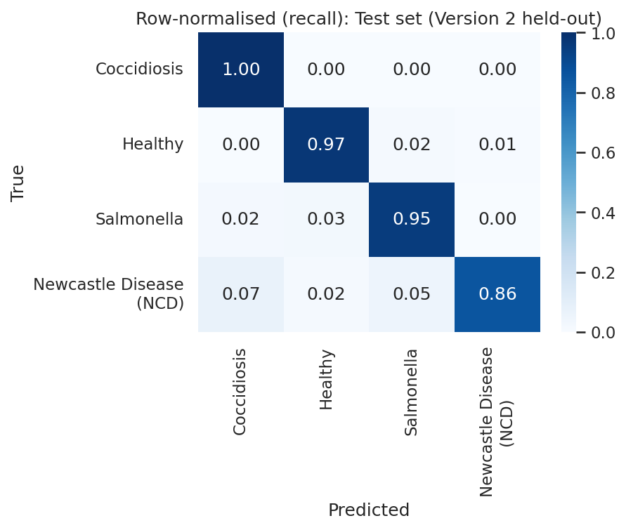 | 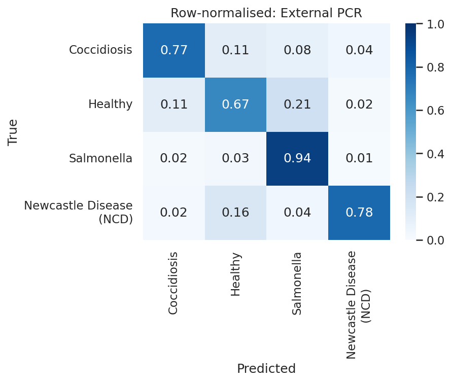 |

The most common external mistakes: **Healthy → Salmonella** (65 of 312, 20.8%), **NCD → Healthy** (29 of 186,
15.6%) and Coccidiosis → Healthy (39 of 357, 10.9%) ([`external_confusions.json`](results/posthoc/external_confusions.json)).
NCD taken for Healthy is the costly direction.

<p align="center">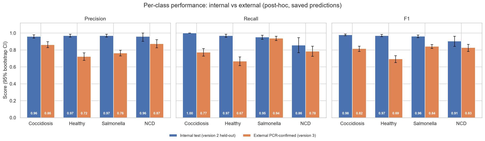</p>

### Confidence intervals and run-to-run variability (post-hoc)

The intervals above come from a stratified bootstrap of the saved predictions (10,000 resamples). They capture
test-set sampling noise, not training noise. For the latter, five runs with the same configuration, seed and
split, differing only through GPU non-determinism (two on TF 2.20, three on 2.21), are compared in
[`run_variability.json`](results/posthoc/run_variability.json):

| Run | Internal macro-F1 | External accuracy | External macro-F1 |
|---|---|---|---|
| 20260927_131854 | 0.969 | 0.754 | 0.749 |
| 20260927_151041 | 0.960 | 0.743 | 0.729 |
| 20261029_141903 | 0.957 | 0.758 | 0.756 |
| 20261029_171740 | 0.960 | 0.765 | 0.765 |
| **20261029_191001 (published)** | 0.954 | **0.795** | **0.794** |
| Mean (sd) | 0.960 (0.005) | 0.763 (0.020) | 0.759 (0.024) |

The published run is the one the committed notebook documents. It happens to be the best of the five on the
external set (and the worst on the internal one), so its external score is on the optimistic side of what this
recipe produces. The runs agree on 96.9% of internal images but only 79.4% of external ones.

### Calibration (post-hoc)

<p align="center">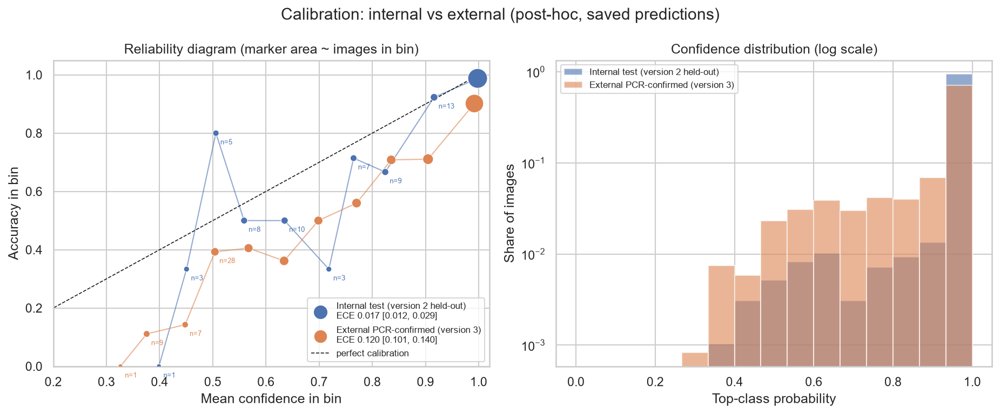</p>

| | Mean confidence | Accuracy | ECE (95% CI) | Images at ≥ 0.99 confidence | Accuracy there |
|---|---|---|---|---|---|
| Internal | 0.981 | 0.967 | 0.017 (0.012 to 0.029) | 89.1% | 0.997 |
| External | 0.915 | 0.795 | 0.120 (0.101 to 0.140) | 55.4% | 0.935 |

On the internal set a 99% answer is right 99.7% of the time; on the PCR set, 93.5%. Probabilities that are
well calibrated in-distribution become overconfident under domain shift.

### Showing "uncertain" instead of a verdict

The app shows a verdict only when the top probability is at least 0.50 **and** leads the runner-up by at
least 0.90; otherwise it says "uncertain". The thresholds were picked on the **internal** set by
[`choose_thresholds.py`](scripts/choose_thresholds.py) (withhold as many errors as possible while withholding at
most 5% of correct answers), so they are a usability heuristic, not a validated operating point
([`thresholds.json`](results/posthoc/thresholds.json)):

| | Verdict shown | Accuracy of shown verdicts | Errors withheld |
|---|---|---|---|
| Internal | 93.7% | 98.9% | 22 of 32 |
| External | 69.5% | 90.7% | 168 of 246 |

<p align="center">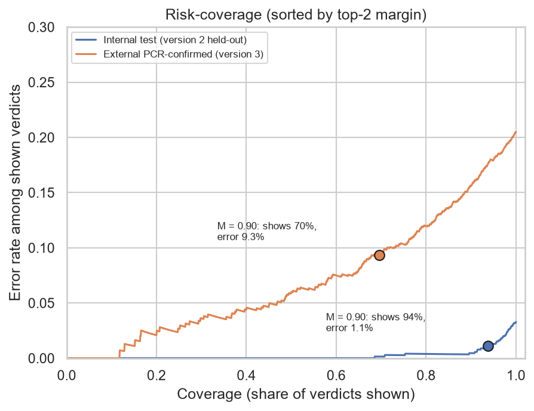</p>

### ROC and precision-recall curves, training history, error analysis

| | |
|---|---|
| 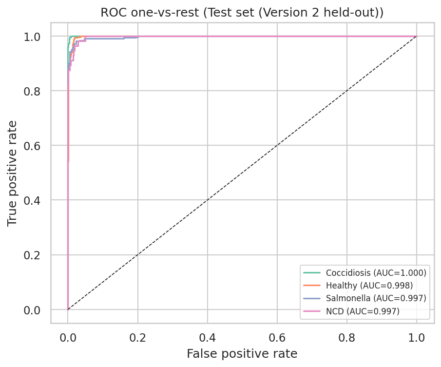 | 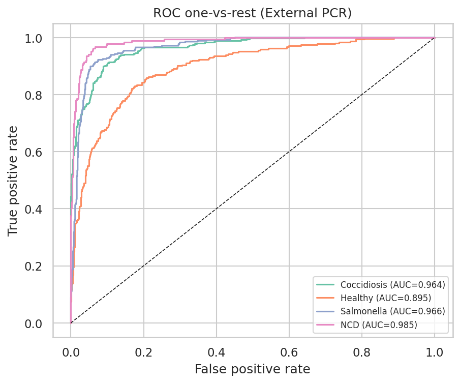 |
| 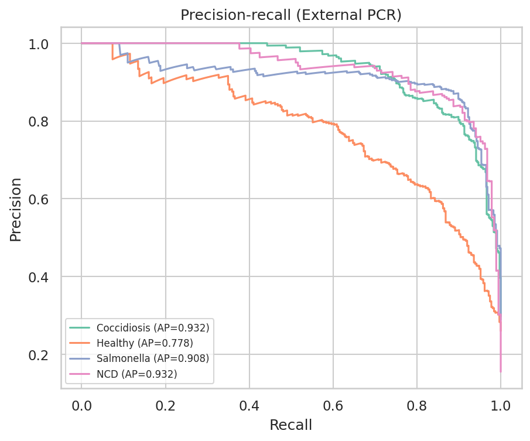 | 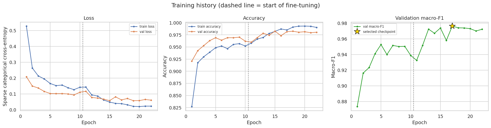 |

The notebook's error grids ([internal](results/figures/error_grid.png), [PCR](results/figures/pcr_error_grid.png))
show the misclassified photos. Many internal errors are Salmonella photos taken for Healthy or Coccidiosis
(15 of 32 internal errors are true Salmonella).

## Explainability

<p align="center">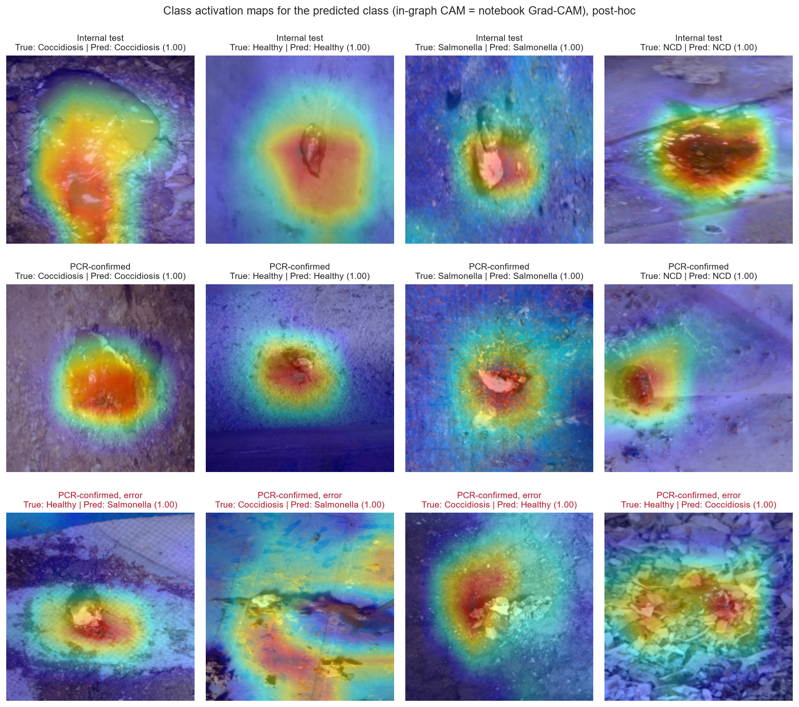</p>

The class activation maps above (post-hoc, [`posthoc_cam_grid.py`](scripts/posthoc_cam_grid.py)) show, for one
confident correct prediction per class on each test set, warm regions centred on the droppings. In the
bottom row, the four most confident PCR-set errors of different kinds are more mixed: two still centre on the
droppings, while for a Coccidiosis photo taken for Salmonella and a Healthy photo taken for Coccidiosis the
evidence spreads across a smeared floor and wood-shaving litter. The notebook's own Grad-CAM figures for the
internal set are in [`results/gradcam/`](results/gradcam).

What the maps **suggest**, with appropriate hedging: when the model is wrong on new photos, it is sometimes
reading the surroundings rather than the droppings. Together with the way version 2 was collected (Salmonella
and NCD from inoculated birds, the other classes from farms), this is consistent with the model having learnt
part of the capture setting, which would explain much of the domain gap. Twelve images are not a measurement;
testing this properly needs droppings photographed against matched backgrounds, or segmentation masks.

**The CAM in the browser, without gradients.** TF.js graph models cannot backpropagate, but for a global
average pooling + linear head, Grad-CAM needs no gradients:

$$
y^c = \sum_k w_k^c \frac{1}{HW}\sum_{i,j} A^k_{ij} + b^c
\;\Rightarrow\;
\alpha_k^c = \frac{1}{HW}\sum_{i,j}\frac{\partial y^c}{\partial A^k_{ij}} = \frac{w_k^c}{HW}
\;\Rightarrow\;
\text{Grad-CAM}^c = \mathrm{ReLU}\Big(\sum_k \alpha_k^c A^k\Big) = \frac{1}{HW}\,\mathrm{ReLU}\Big(\sum_k w_k^c A^k\Big)
$$

The notebook's Grad-CAM differentiates the class logit (before the softmax), so this holds exactly. The
inference graph ([`model.py`](src/poultry_disease/model.py)) adds a 1 × 1 convolution carrying the Dense
weights, and one forward pass returns the probabilities and all four 7 × 7 class maps. On the 18 fixtures the
maps correlate with the notebook's gradient-based Grad-CAM at **r ≥ 0.99999999999**.

## Limitations and threats to validity

1. **Domain shift.** 96.7% internal vs 79.5% external accuracy. The internal test set shares photographers,
   farms, capture settings and, for two classes, the inoculation setting with the training data.
2. **Capture confound.** Salmonella and NCD training photos come from inoculated birds, Healthy and
   Coccidiosis from farms; part of what the model learnt may be the setting (see [Explainability](#explainability)).
3. **Label noise.** Version 2 labels come from the collection context, not from a test of each sample, and 19
   groups of identical images carried conflicting labels (removed). Even PCR labels can be imperfect, for
   example for birds carrying a pathogen without disease.
4. **Single seed per run, best of five.** Five runs with the same seed differ by up to 6.5 points of external
   macro-F1, and this one is the best; the five-run mean external accuracy is 76.3%.
5. **Small external NCD count.** 186 PCR-confirmed NCD photos (and 56 internal): NCD metrics are the least
   certain.
6. **A closed set of four answers.** No "not poultry droppings" class: 8 of 12 unrelated photos got a confident
   verdict ([`docs/ood/`](docs/ood/README.md)). No "mixed infection" class either.
7. **Uncalibrated probabilities** on new data (ECE 0.120 external); temperature scaling is future work.
8. **One region, one season, phone photos.** Arusha and Kilimanjaro, Tanzania, September 2020 to February
   2021. Other breeds, litter, floors, lighting and cameras are untested.
9. **No veterinary or field validation.** Not tested by veterinarians, on farms or against outcomes.

## The web app

**Live:** <https://peerzadarabet1807.github.io/poultry-disease-detection/>

| | |
|---|---|
| 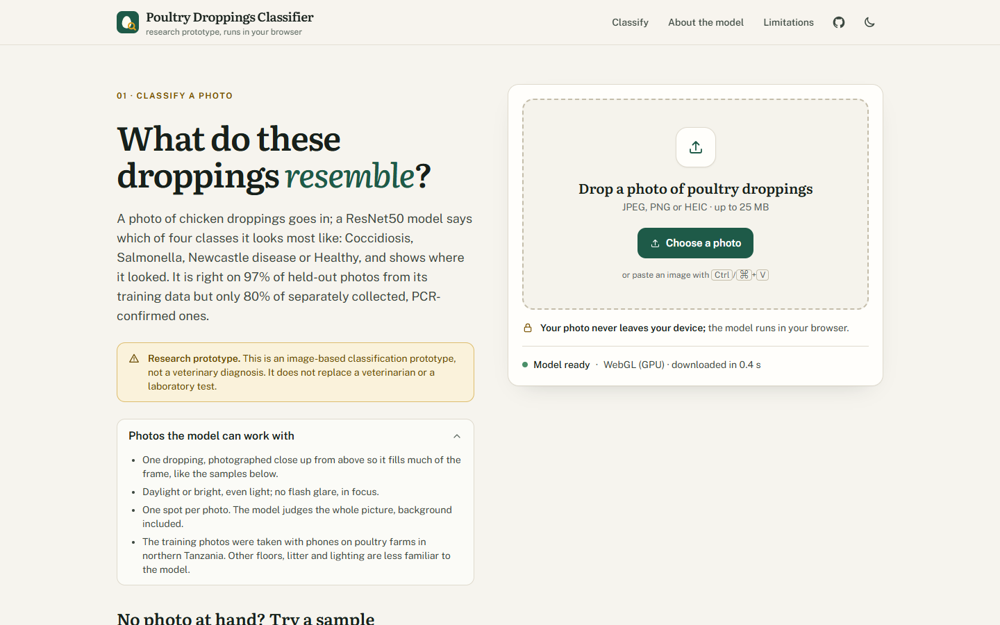 | 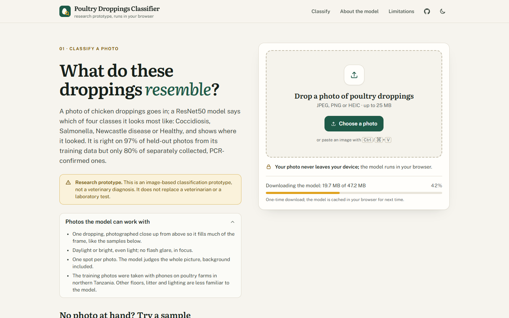 |
| **Landing:** drop, pick, paste or photograph | **First visit:** 47 MB model with progress, then cached |
| 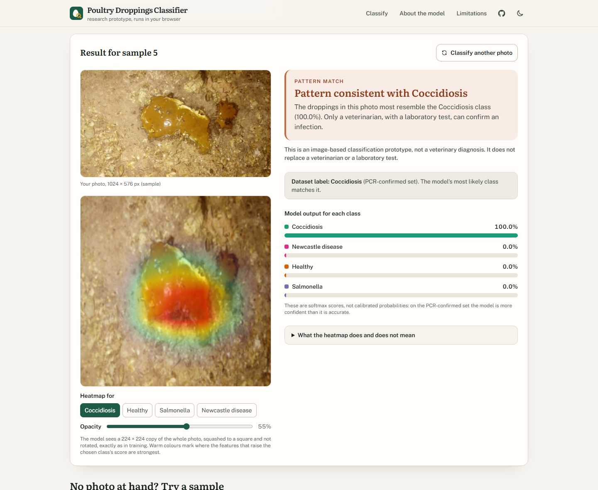 | 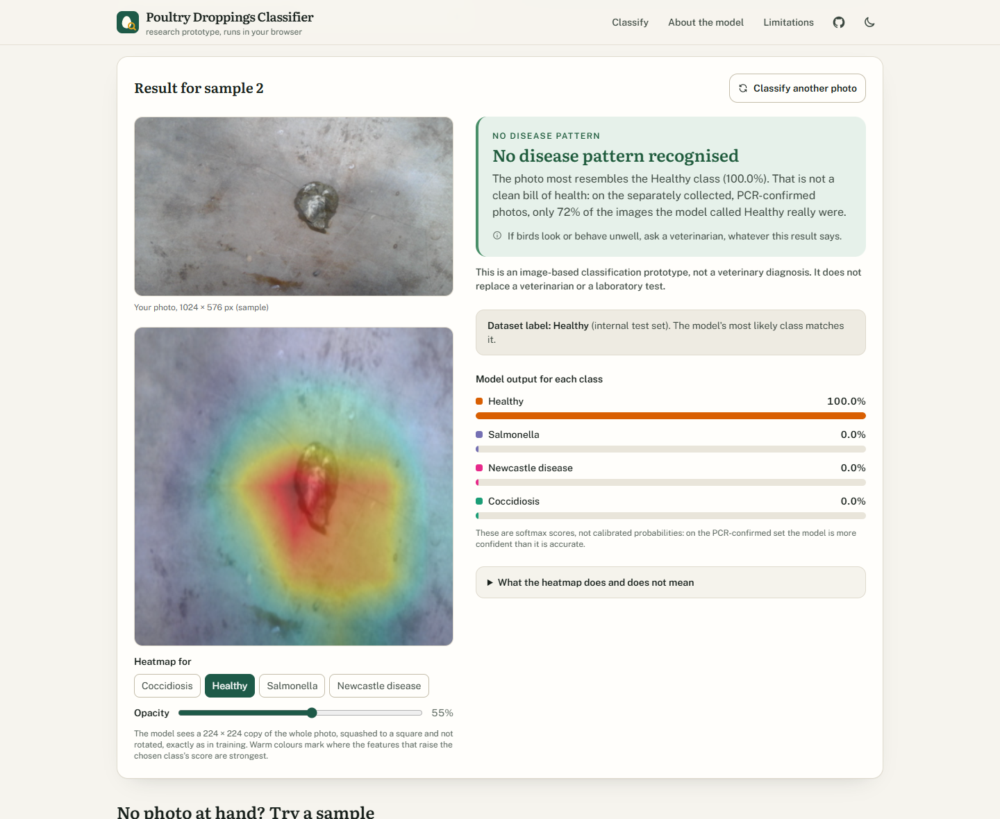 |
| **Coccidiosis:** "Pattern consistent with", never "Diagnosis" | **Healthy:** explicitly not a clean bill of health |
| 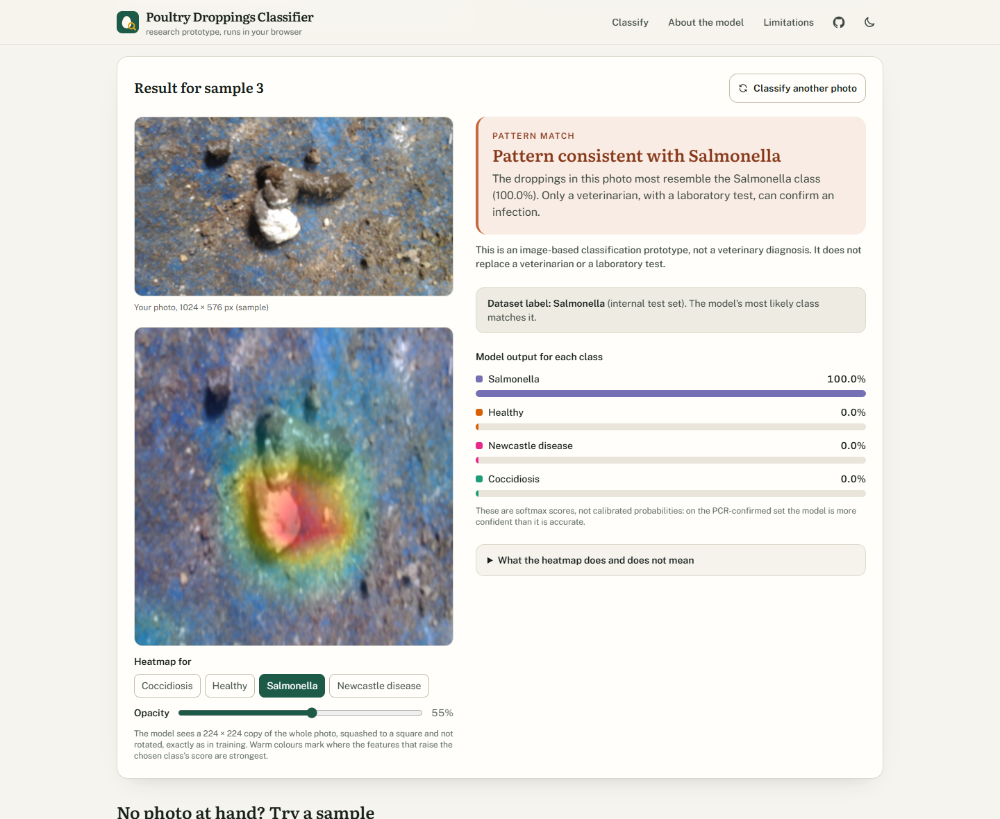 |  |
| **Salmonella** | **Newcastle disease:** notifiable, contact a vet promptly |
| 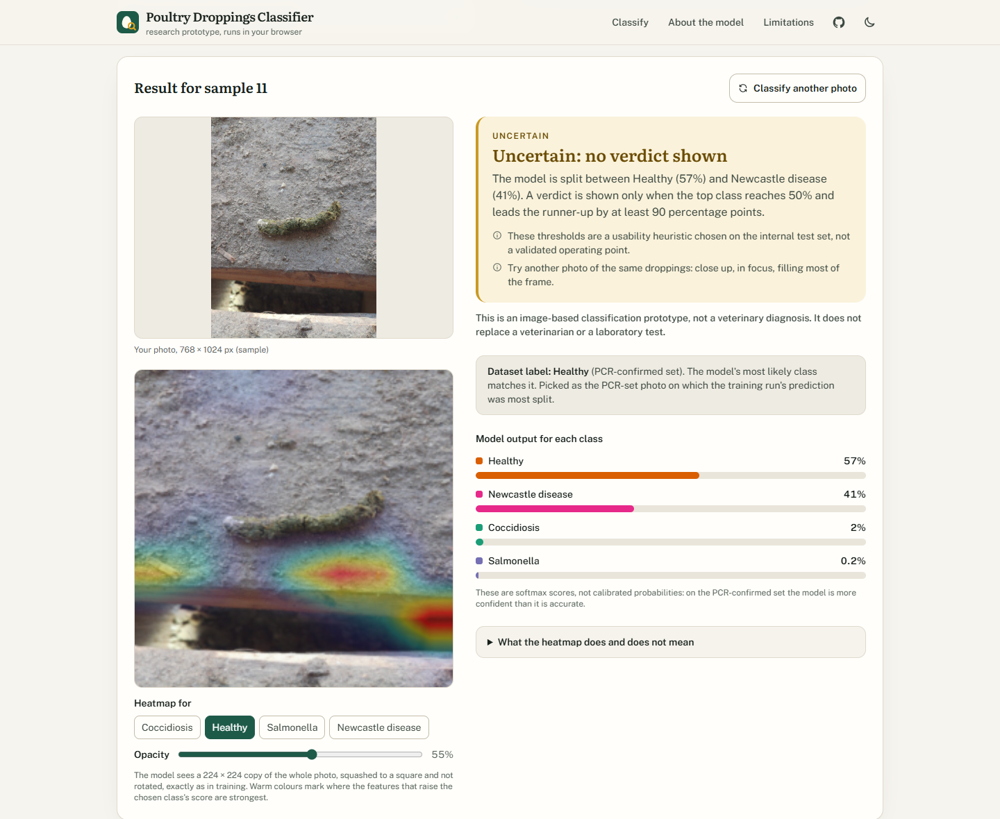 | 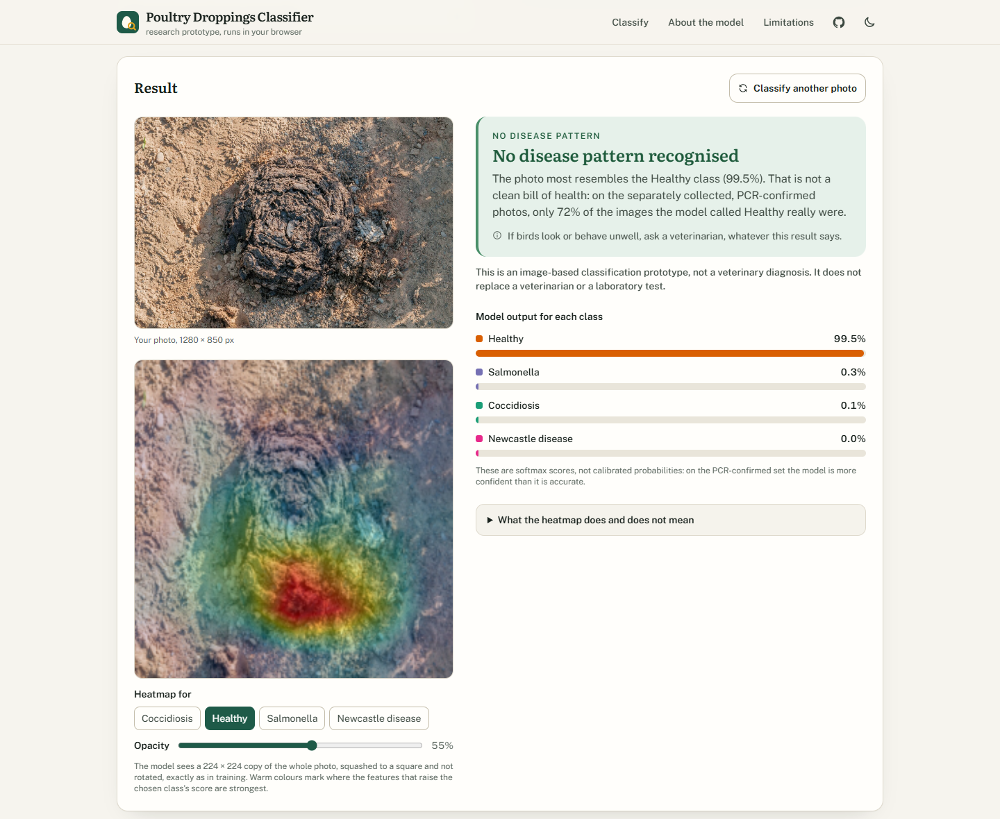 |
| **Uncertain:** 57% vs 41%, so no verdict; the heatmap sits on the floor | **Not poultry:** cow dung (CC0) gets a confident "Healthy" |
| 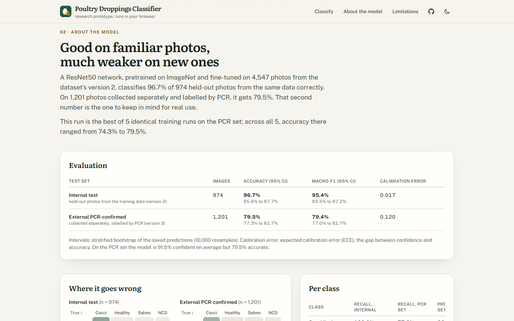 | 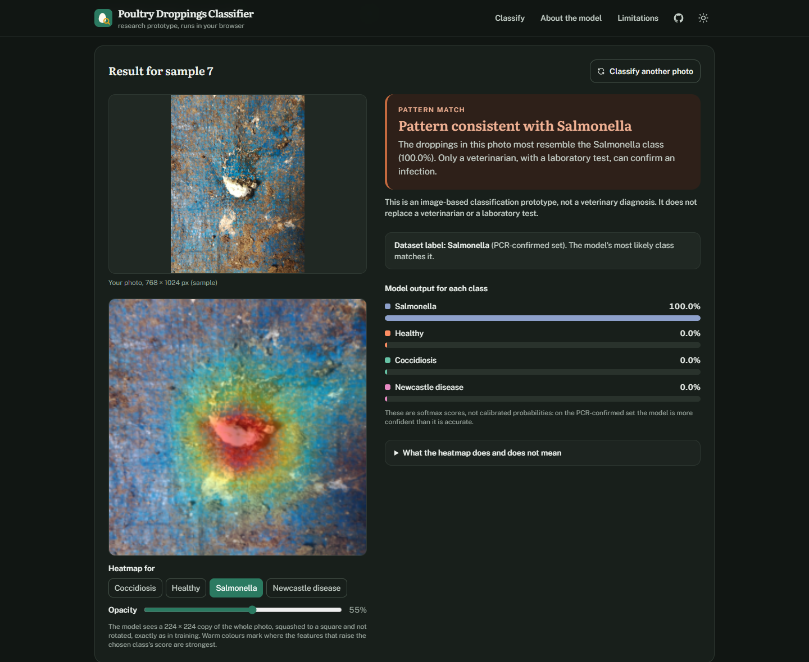 |
| **About the model:** every number read from `results/` | **Dark mode** |

<p align="center">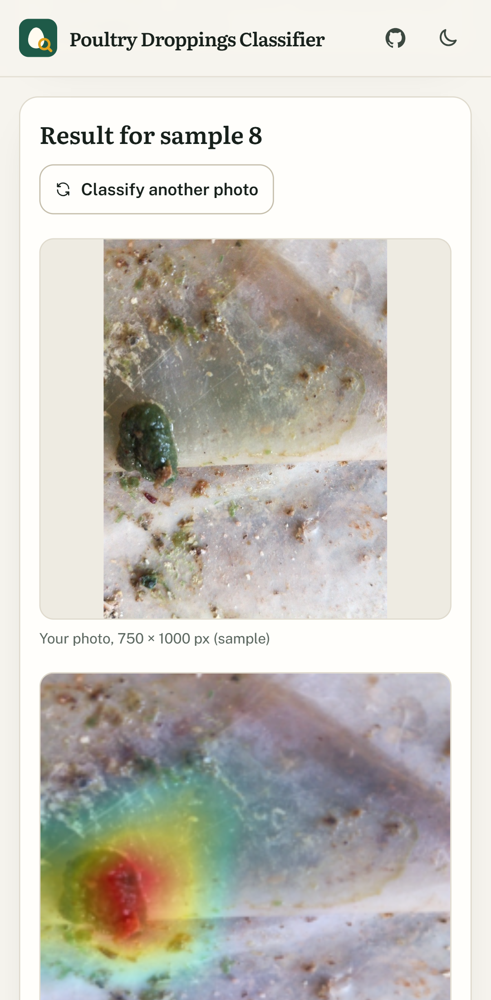</p>

All screenshots were captured from the production build with
[`web/scripts/capture-screenshots.ts`](web/scripts/capture-screenshots.ts).

**Features**
- Drag-and-drop, file picker, paste (Ctrl/⌘+V) and, on phones, **Take a photo**. JPEG, PNG and **HEIC** (decoded
  natively in Safari or with a lazily loaded `heic2any` elsewhere). Files are checked by signature, with a
  25 MB limit and clear messages.
- **Samples:** 11 dataset photos (CC BY 4.0) from both test sets, including two confident mistakes and one
  split case; the dataset label is revealed after classification.
- **Responsible verdicts.** "Pattern consistent with …" for disease classes; Healthy is "No disease pattern
  recognised", with the PCR-set precision; a notifiable-disease notice whenever NCD is the top class; an
  **uncertain** state below the thresholds, labelled a usability heuristic.
- **Class activation map** for any class, over the exact 224 × 224 image the model saw, with an opacity slider
  and an explanation of what the map does and does not mean. A note appears when a photo carries an EXIF
  rotation tag (the model, like training, reads the unrotated pixels).
- **About the model**, rendered from the committed results: both test sets with intervals, confusion matrices,
  calibration, run variability, the OOD check and limitations.
- TF.js in a **Web Worker** (Comlink), **WebGL → WASM → CPU** fallback, **IndexedDB** model cache keyed by the
  model's content hash, explicit tensor disposal (a test checks for leaks), warm-up with parallel shader
  compilation.
- Keyboard navigation, visible focus, an ARIA live region for results, AA contrast in both themes.

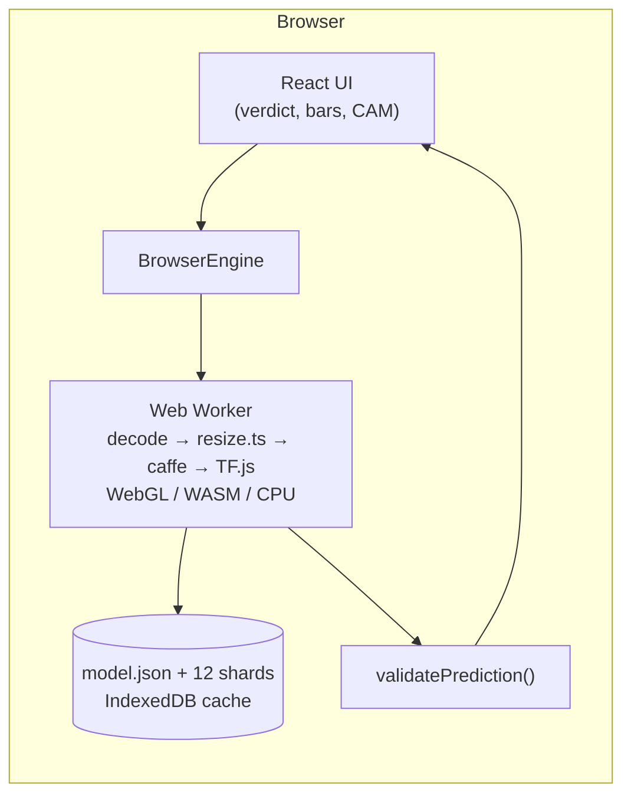

There is no server: the page, the model and the sample photos are static files on GitHub Pages, and a photo you
classify never leaves your device. Whatever the worker returns is checked by `validatePrediction` (four
probabilities summing to one, four 7 × 7 class maps, the 224 × 224 image the model saw) before the UI shows it.

**Preprocessing parity** ([`models/PARITY.md`](models/PARITY.md)):

| Check | Result |
|---|---|
| Python package vs notebook (Colab GPU), 18 fixtures | same top class 18 / 18, max prob. difference **2.2e-6** |
| Python package vs notebook, all 2,175 evaluation images | **2,175 / 2,175**, max **5.7e-6** |
| TypeScript resize vs `tf.image.resize`, golden images | **bit-identical** |
| Browser model input from the original JPEGs vs Python (same IDCT), Chromium, Firefox, WebKit | **bit-identical** |
| TF.js float16 (shipped) vs Keras, same input | 18 / 18, max prob. difference **0.0017**, CAM r ≥ 0.99999 |
| TF.js uint8 vs Keras | 17 / 18, max 0.170: **rejected** |

One step cannot be matched: training decoded JPEGs with TensorFlow's **fast** integer IDCT, and browsers use the
accurate one. Over all 2,175 evaluation images this changes the top class on 6 internal (0.6%) and 15
external (1.2%) photos. All 21 were close calls (top-2 margin at most 0.24) that the app already shows as
"uncertain", and the model is no better or worse overall (external accuracy 79.5% vs 79.9%).

**Lighthouse** (13.5.0, median of 3 runs, [`docs/lighthouse/summary.json`](docs/lighthouse/summary.json))

| | Performance | Accessibility | Best practices | SEO |
|---|---|---|---|---|
| Mobile, excluding the model download | **95** | 100 | 100 | 100 |
| Desktop, excluding the model download | **100** | 100 | 100 | 100 |
| Mobile, model downloading in the background | 66 | 100 | 100 | 100 |
| Desktop, model downloading in the background | 100 | 100 | 100 | 100 |

"Excluding the model download" loads the page with `?preload=0`; by default the 47 MB model starts downloading
after the page has loaded, which costs main-thread time on a throttled phone.

## Reproduce the training

1. Open the notebook with the Colab badge above and choose **Runtime → Change runtime type → T4 GPU**.
2. Put the two Zenodo datasets in `MyDrive/poultry-disease-dataset-zenedo/` as `version-2/{cocci,healthy,salmo,ncd}`
   and `version-3/{pcrcocci,pcrhealthy,pcrsalmo,pcrncd}`.
3. **Runtime → Run all.** Outputs go to `MyDrive/poultry-output/run_<timestamp>/`, with a zip next to it.

Training took 13.8 minutes on a T4 (TensorFlow 2.21.0, Keras 3.13.2). GPU kernels are not deterministic, so a
rerun gives slightly different numbers (see the run table above). The executed notebook, with all outputs, is in
[`notebooks/`](notebooks/poultry_disease_resnet50_training_executed.ipynb); its artifacts are in [`results/`](results).

**Use the Python package** (Python 3.10 to 3.13):

```bash
pip install -e ".[dev]"
python scripts/fetch_weights.py           # downloads poultry_resnet50.keras, checks its SHA-256, caches it
python -c "from poultry_disease import Predictor; print(Predictor.from_release().predict_image('web/public/samples/f05.jpg').to_dict())"
pytest                                     # 33 tests; parity tests run when the weights are available
```

## Run the web app locally

```bash
cd web
npm ci
npm run dev            # http://localhost:5173/poultry-disease-detection/
npm test               # unit tests (Vitest)
npm run test:parity    # TF.js vs Keras on the committed fixtures (Node, WASM)
npm run lint && npm run typecheck
npm run build && npm run preview
npx playwright install chromium firefox webkit
npm run e2e            # Playwright: Chromium, Firefox, WebKit and an emulated Pixel 7
```

**Rebuild the browser model** (Python 3.11; the converter gets its own venv, as in the saffron project):

```bash
python scripts/build_web_model.py          # probs + CAM graph, checked against Keras and Grad-CAM
bash scripts/convert_to_tfjs.sh            # float16 and uint8 candidates in build/tfjs/
python scripts/make_web_references.py      # golden tensors and Keras references
PARITY_MODEL_DIR=../build/tfjs/float16 npm --prefix web run test:parity
bash scripts/convert_to_tfjs.sh --install float16
```

## Repository structure

```
├── notebooks/        executed Colab training notebook (outputs kept)
├── results/          metrics, reports, figures/, gradcam/ from the run; posthoc/ analyses; parity/ reports;
│                     other_runs/ (four more runs with the same configuration)
├── models/           class names, model config, MODEL_CARD.md, PARITY.md, checksums (weights: GitHub Release)
├── src/poultry_disease/   installable package: preprocessing, model + CAM head, inference, verdict, weights
├── web/              Vite + React + TypeScript app
│   ├── public/model/     TF.js graph model (float16, 12 shards of at most 4 MiB)
│   ├── public/samples/   11 dataset photos (1024 px, CC BY 4.0) + manifest
│   ├── src/              UI, engine, worker, preprocessing, CAM
│   └── tests/            unit, parity and Playwright tests + fixtures
├── tests/            Python tests and the 18 parity fixtures (CC BY 4.0)
├── scripts/          fetching, release packaging, post-hoc analyses, web model build, TF.js conversion,
│                     references, samples, OOD evaluation
├── docs/             PLAN.md, screenshots, ood/ (non-poultry photos with credits), Lighthouse summary
└── .github/workflows CI (Python, web) and GitHub Pages deploy
```

## Model card

See [`models/MODEL_CARD.md`](models/MODEL_CARD.md) for intended use, out-of-scope uses, data, metrics,
calibration, failure modes and ethical considerations. In short: a research and teaching prototype for close-up
photos of poultry droppings. It must not be used for diagnosis, treatment, culling or reporting decisions.

## Roadmap

- [ ] **Multi-seed study** (deterministic ops, several seeds) to replace the best-of-five headline with a mean
- [ ] A **combined-data run** that trains on part of the PCR set and tests on the rest
- [ ] **Background-controlled re-capture**: all classes photographed on matched floors and litter
- [ ] An **out-of-distribution rejection** class or detector ("not poultry droppings")
- [ ] **Temperature scaling** on a held-out calibration split from the target domain
- [ ] **Field validation** with local farms and a veterinarian, with laboratory confirmation

## Citation

If you use this work, please cite it (see [`CITATION.cff`](CITATION.cff)) and the dataset:

```bibtex
@software{rabet_poultry_disease_2026,
  author  = {Rabet, Peerzada Mohammad},
  title   = {Poultry disease image classification: a ResNet50 prototype with in-browser CAM and an honest external evaluation},
  year    = {2026},
  version = {1.0.0},
  url     = {https://github.com/peerzadarabet1807/poultry-disease-detection}
}

@dataset{machuve_poultry_v2_2021,
  author    = {Machuve, Dina and Nwankwo, Ezinne and Mduma, Neema and Mbelwa, Hope and Maguo, Evarist and Munisi, Charles},
  title     = {Machine Learning Dataset for Poultry Diseases Diagnostics},
  version   = {2},
  publisher = {Zenodo},
  year      = {2021},
  doi       = {10.5281/zenodo.4628934}
}

@dataset{machuve_poultry_v3_2021,
  author    = {Machuve, Dina and Nwankwo, Ezinne and Lyimo, Emmanuel and Maguo, Evarist and Munisi, Charles},
  title     = {Machine Learning Dataset for Poultry Diseases Diagnostics - PCR annotated},
  version   = {3},
  publisher = {Zenodo},
  year      = {2021},
  doi       = {10.5281/zenodo.5801834}
}
```

**Related work.** Machuve, D., Nwankwo, E., Mduma, N., & Mbelwa, J. (2022). *Poultry diseases diagnostics
models using deep learning.* Frontiers in Artificial Intelligence, 5, 733345.
<https://doi.org/10.3389/frai.2022.733345> (a [correction](https://doi.org/10.3389/frai.2022.1016695) was
published). This repository is independent work and is not affiliated with the dataset authors.

## Acknowledgements

The photos and labels are the work of Dina Machuve, Ezinne Nwankwo, Neema Mduma, Hope Mbelwa, Emmanuel Lyimo,
Evarist Maguo and Charles Munisi (Nelson Mandela African Institution of Science and Technology, Duke University
and Elang'ata Agrovet Services), funded by the International Development Research Centre (IDRC, grant
109187-002) and the Organization for Women in Science for the Developing World (OWSD, grant 4500406715), as
credited on Zenodo. Thank you for publishing them openly. The non-poultry test photos are by Wikimedia Commons
contributors, credited in [`docs/ood/`](docs/ood/README.md). Fonts are Literata and Public Sans (SIL OFL 1.1).

## License and contact

Code and model weights: [MIT](LICENSE). The dataset photos in `tests/fixtures/` and `web/public/samples/` are
CC BY 4.0 (Machuve et al.); the photos in `docs/ood/` keep their own licenses.

**Peerzada Mohammad Rabet** · GitHub [@peerzadarabet1807](https://github.com/peerzadarabet1807) ·
peerzada.rabet2@gmail.com
