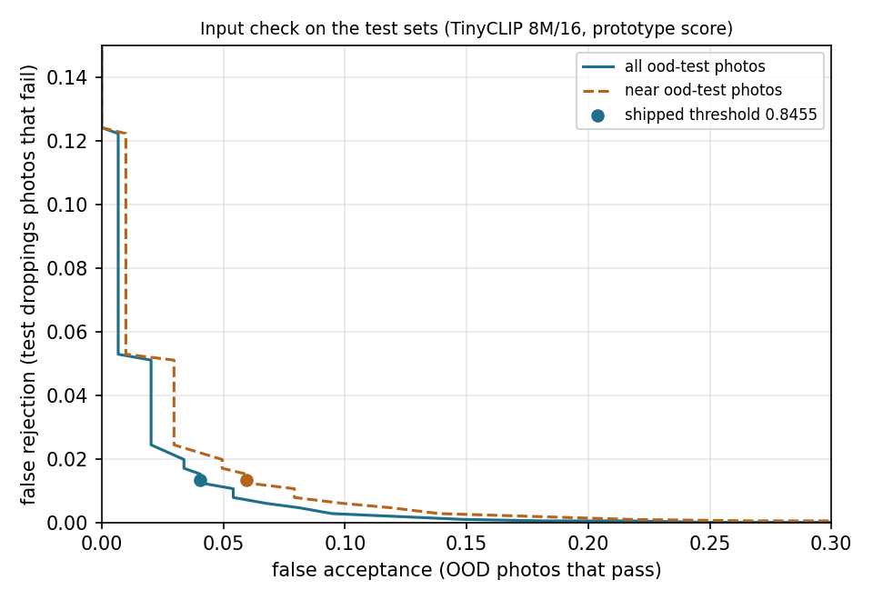

# Input check: evaluation of the shipped gate

Written by [`scripts/build_input_check.py`](../../scripts/build_input_check.py). Gate `tinyclip-8m16-proto-1`: TinyCLIP ViT-8M/16 image embedding, cosine to the nearest of four class prototypes, threshold 0.845506 (highest value with at most 1% false rejection on the validation split). The test sets below played no part in any choice. Rates: percent (count; 95% Wilson interval).

## False rejection (droppings photos the check turns away)

| Class | Validation (tuning) | Internal test | PCR-confirmed test |
|---|---|---|---|
| Coccidiosis | 1.7% (5/296; 0.7 to 3.9) | 0.0% (0/296; 0.0 to 1.3) | 3.1% (11/357; 1.7 to 5.4) |
| Healthy | 0.0% (0/306; 0.0 to 1.2) | 0.3% (1/308; 0.1 to 1.8) | 2.9% (9/312; 1.5 to 5.4) |
| Salmonella | 1.3% (4/315; 0.5 to 3.2) | 1.9% (6/314; 0.9 to 4.1) | 0.3% (1/346; 0.1 to 1.6) |
| NCD | 0.0% (0/56; 0.0 to 6.4) | 1.8% (1/56; 0.3 to 9.4) | 0.0% (0/186; 0.0 to 2.0) |
| **All** | 0.9% (9/973; 0.5 to 1.7) | 0.8% (8/974; 0.4 to 1.6) | 1.7% (21/1201; 1.1 to 2.7) |

Both test sets together: 1.3% (29/2175; 0.9 to 1.9).

## False acceptance (ood-test photos that pass)

| Category | Near or far | Passed |
|---|---|---|
| cow dung | near | 0.0% (0/8; 0.0 to 32.4) |
| dog feces | near | 0.0% (0/9; 0.0 to 29.9) |
| eggs | near | 12.5% (1/8; 2.2 to 47.1) |
| feathers | near | 0.0% (0/8; 0.0 to 32.4) |
| goose duck droppings | near | 0.0% (0/8; 0.0 to 32.4) |
| horse manure | near | 28.6% (2/7; 8.2 to 64.1) |
| litter bedding | near | 0.0% (0/9; 0.0 to 29.9) |
| live poultry | near | 0.0% (0/9; 0.0 to 29.9) |
| lookalike food | near | 0.0% (0/10; 0.0 to 27.8) |
| other animal droppings | near | 12.5% (1/8; 2.2 to 47.1) |
| soil mud | near | 0.0% (0/7; 0.0 to 35.4) |
| wild bird droppings | near | 20.0% (2/10; 5.7 to 51.0) |
| documents | far | 0.0% (0/8; 0.0 to 32.4) |
| everyday objects | far | 0.0% (0/8; 0.0 to 32.4) |
| other animals | far | 0.0% (0/8; 0.0 to 32.4) |
| people | far | 0.0% (0/7; 0.0 to 35.4) |
| scenes | far | 0.0% (0/8; 0.0 to 32.4) |
| screenshots | far | 0.0% (0/8; 0.0 to 32.4) |
| **All near** | near | 5.9% (6/101; 2.8 to 12.4) |
| **All far** | far | 0.0% (0/47; 0.0 to 7.6) |
| **All** | | 4.1% (6/148; 1.9 to 8.6) |

On ood-tune (seen while choosing the gate): near 5.9% (4/68; 2.3 to 14.2), far 0.0% (0/35; 0.0 to 9.9).

Passing ood-test photos: `pigeon_droppings.jpg`, `set/eggs/an_egg_carton.jpg`, `set/horse_manure/manure_07.jpg`, `set/horse_manure/manure_from_a_horse.jpg`, `set/other_animal_droppings/usfws_pygmy_rabbit_droppings_22720443575.jpg`, `set/wild_bird_droppings/due_fuglem_kk_avf_ring_skitten_hvitmalt_vegg_mot_biltrafikk_.jpg`.

AUROC, test droppings photos against ood-test: 0.9975 (near only: 0.9964).

## Shipped sample photos

11 of 11 pass.

## Post-hoc observations

Not used for any choice.

| Test set | Classifier wrong | Rejected when wrong | Rejected when right |
|---|---|---|---|
| internal test set | 32 of 974 | 3.1% (1/32; 0.6 to 15.7) | 0.7% (7/942; 0.4 to 1.5) |
| PCR-confirmed external test set | 246 of 1201 | 1.6% (4/246; 0.6 to 4.1) | 1.8% (17/955; 1.1 to 2.8) |

On ood-test photos the classifier alone would show a verdict (not 'uncertain') for 41.9% (62/148; 34.2 to 49.9); with the input check in front, for 4.1% (6/148; 1.9 to 8.6).
